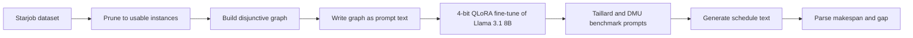

# LLMs for Job-Shop Scheduling

Can a fine-tuned language model read a job-shop scheduling problem as text and write a valid schedule? This project fine-tuned Llama 3.1 8B to find out. On benchmark-size problems it could not, and this repo documents the pipeline and why it failed.

Course research for EECS 6412 (Data Mining), York University, under Prof. Aijun An, September to December 2025. Team of three.

## Why it matters

Job-shop scheduling decides which machine runs which task, and in what order. Better schedules finish the same work sooner. Classical solvers handle this well but need a formal model for every problem. If a language model could produce usable schedules from a plain description, planners could work without that modelling step. This project tests that idea at small scale.

## Key finding

The fine-tuned model produced no valid schedules on the Taillard and DMU benchmarks. It repeated a single token.

The cause was prompt length. Each instance is written into the prompt as a graph of job chains and machine sets. For benchmark sizes (15 to 50 jobs on 15 to 20 machines) that text is longer than the 4,096-token limit the model was trained with, so the instruction that starts the answer was cut off.

The lesson is about representation, not model size: a text encoding that grows with every operation cannot reach realistic instance sizes within a fixed context window.

## What was built

| Step | Detail |
|---|---|
| Data | Starjob dataset. Pruned from about 130,000 instances to 9,525 usable ones. |
| Training cost | The pruning cut fine-tuning time from about 70 hours to about 11.5 hours. |
| Model | Llama 3.1 8B, 4-bit QLoRA with Unsloth, LoRA rank 64 and alpha 64, maximum length 4,096 tokens. |
| Hardware | Google Colab T4 for development, then a rented NVIDIA RTX A6000 on RunPod. |
| Representation | Each instance becomes a disjunctive graph (NetworkX, stored as PyTorch Geometric data objects), then is written into the prompt as text. |

No graph neural network is trained in this project. The graph is a data structure that is serialized into the prompt.

The data and timing figures come from the team's course report. The notebooks in this repo were saved without their outputs.

## How it works

- `1_train_llama_3_gnn.ipynb`: filters the dataset, builds the graphs, writes the prompts and runs the fine-tune (`SFTTrainer`, tracked with Weights and Biases).
- `2_evaluation_on_benchmarks.ipynb`: converts the Taillard and DMU benchmark files the same way and runs inference.
- `3_performance_comparison.ipynb`: plots baseline optimality gaps by benchmark and instance size.

## Tech stack

Python, PyTorch, Unsloth, Hugging Face Transformers, Datasets and TRL, PyTorch Geometric (data objects only), NetworkX, Weights and Biases, pandas, Matplotlib.

## Team and roles

Om Patel, Rashid Rasooli and Michael Murphy.

- Michael Murphy wrote the fine-tuning code (notebook 1).
- Om Patel built the benchmark-to-graph conversion, ran the benchmark inference (notebook 2), proposed the dataset pruning and wrote most of the report.

## Limits and known issues

- **No results from the fine-tuned model are saved here.** Model weights, training logs and benchmark outputs are not in the repo.
- **The comparison chart has no real model series.** In notebook 3 the series labelled "Solution (Ours)" is a placeholder copy of the baseline file. It is not model output. `baseline_results.csv` holds the only real numbers: 130 benchmark instances with a mean optimality gap of 22.0%.
- **The prompt leaves out processing times.** It lists operations and machine sets only, so a model could not compute a makespan from the text alone.
- **Operation labels are decoded with a fixed factor.** The decoder assumes 11 operations per job. Benchmark instances have 15 or 20, so labels are wrong for those sizes.
- **The notebooks do not run from this repo alone.** The dataset, the benchmark files and the Google Drive paths must be supplied.

## What I would do next

- Use a compact encoding (one line per job, with machine and duration pairs) so benchmark instances fit the context window.
- Measure prompt length for every instance before training and before inference, and drop or split what does not fit.
- Report validity first (does the output parse into a feasible schedule), then makespan gap against a solver baseline.
